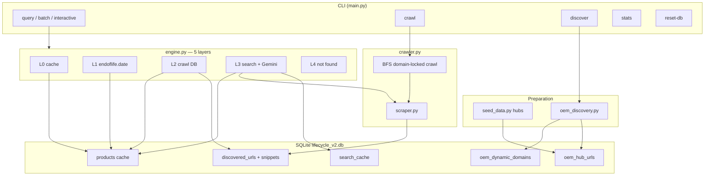
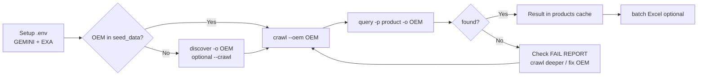
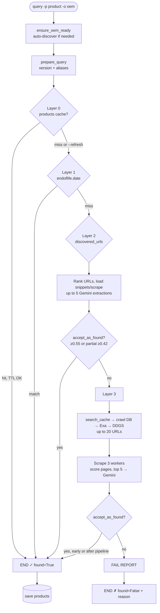
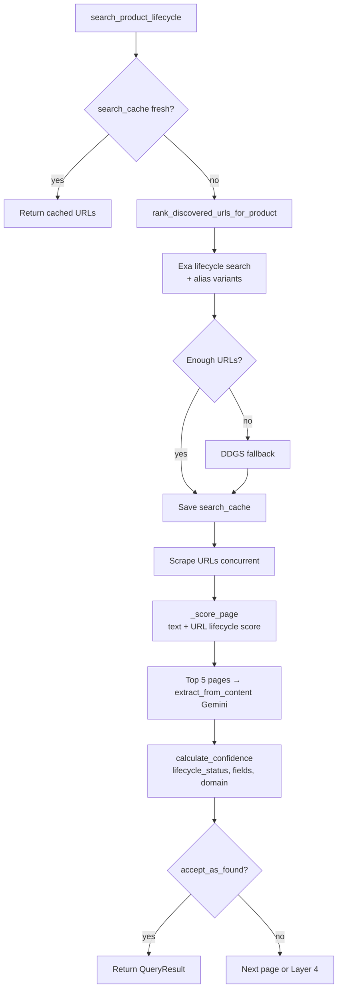
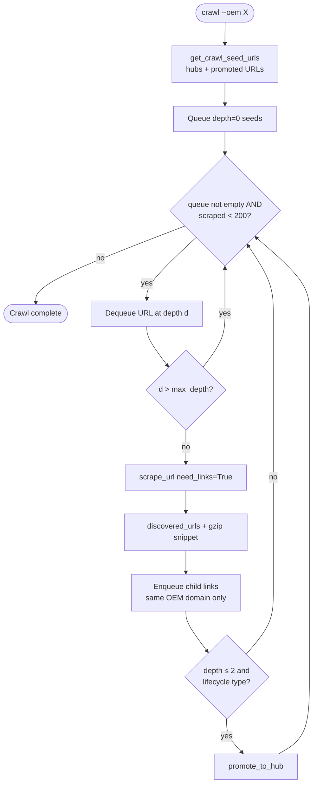
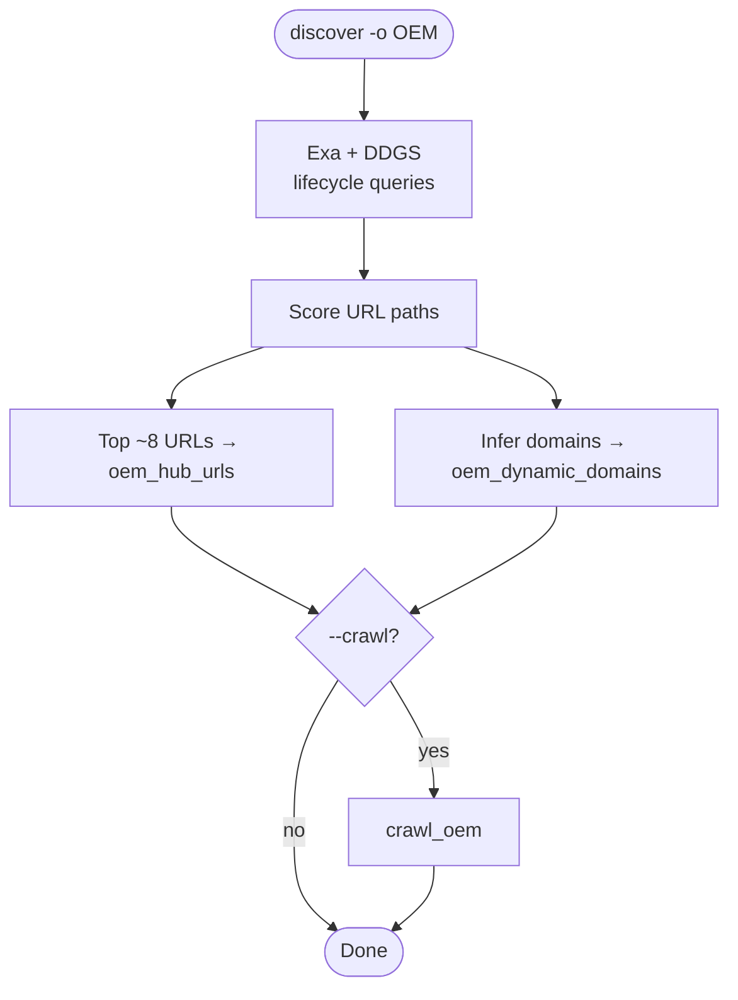
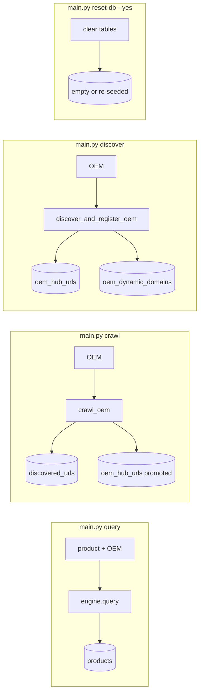
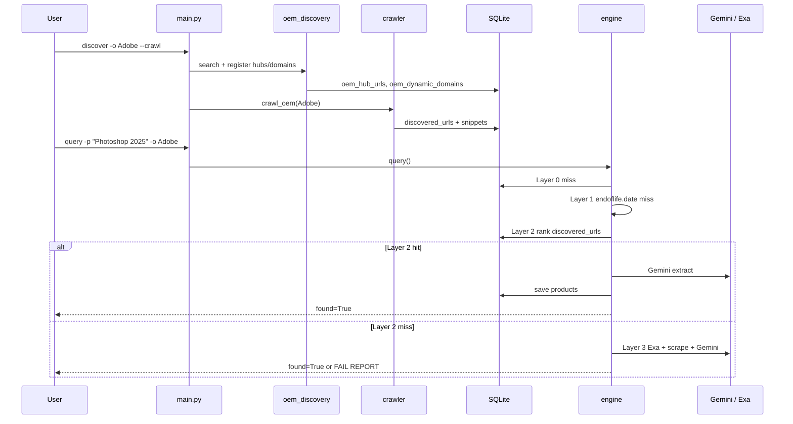

# Product Lifecycle Query Engine v2 — Workflow Diagrams

Reference for how commands, data stores, and the 5-layer query engine fit together.

---

## 1. High-level system



---

## 2. Recommended operational workflow



---

## 3. Query pipeline — when does it end?



### Query stop rules (summary)

| Outcome | Condition |
|--------|-----------|
| **Success (full)** | `confidence ≥ 0.55` |
| **Success (partial)** | `confidence ≥ 0.42` (default) + at least one lifecycle field |
| **Failure** | All layers exhausted without acceptable extraction |
| **Instant** | Layer 0 cache hit (no `--refresh`) |

---

## 4. Layer 3 detail (web search path)



---

## 5. Crawl workflow (BFS)



### Crawl limits

| Setting | Default | How to change |
|--------|---------|----------------|
| **Max depth** | `4` | `--depth N` or `CRAWL_MAX_DEPTH` in `.env` |
| **Max pages scraped / session** | `200` | `MAX_URLS_PER_OEM` in `crawler.py` |
| **Depth meaning** | Link hops from hub | 0 = seed, 1 = child, … |

---

## 6. OEM discovery workflow



Auto-discovery on **query** uses the same hub/domain registration when `OEM_AUTO_DISCOVER=true` and hubs/domains are missing (no BFS unless you run `discover --crawl` separately).

---

## 7. Data flow by command



---

## 8. CLI quick reference

```text
Interactive     python main.py
Query           python main.py query -p "Product" -o "OEM" [--refresh]
Batch           python main.py batch -i in.xlsx -o out.xlsx
Crawl           python main.py crawl --oem "OEM" [--depth N]
                python main.py crawl --all [--depth N]
Discover        python main.py discover -o "OEM" [-p product] [--crawl] [--depth N]
Stats           python main.py stats
Reset           python main.py reset-db --yes [--oem OEM] [--delete-file]
```

Windows: prefix with `.\venv\Scripts\python.exe` if `python` is not on PATH.

---

## 9. Typical end-to-end (new OEM)


